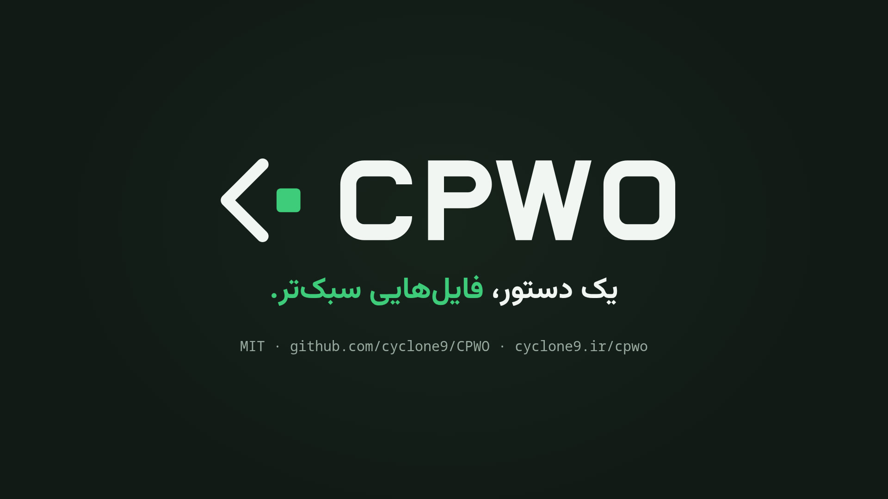

# CPWO - CyClone Power Web Optimizer

[English](README.md) | [فارسی](README.fa.md) | [Türkçe](README.tr.md) | [العربية](README.ar.md)

<p align="center"><picture><source media="(prefers-color-scheme: dark)" srcset="assets/cpwo-lockup-on-dark.svg"></picture></p>

نسخه‌ی ‎1.0.0 (2026-10-24). [CHANGELOG.md](CHANGELOG.md) را ببینید.

یک فایل اجرایی واحد برای کوچک‌سازی HTML، CSS و JS، فشرده‌سازی تصاویر و تبدیل آن‌ها به WebP و AVIF.

از cgo استفاده نمی‌کند و روی ماشینی که آن را اجرا می‌کند، چیزی برای نصب لازم نیست.

<p align="center"><a href="assets/cpwo-video-fa.mp4"></a></p>

<p align="center" dir="rtl">نگاهی ۲۴ ثانیه‌ای به CPWO. برای باز کردن ویدیو روی تصویر کلیک کنید.</p>

```
cpwo [flags] <project-path>...
```

آن را روی یک پوشه‌ی پروژه اجرا کنید.
CPWO پوشه را به‌صورت بازگشتی اسکن می‌کند و هر نتیجه را کنار فایلی که از آن ساخته شده می‌نویسد.
فایل‌های منبع شما هرگز تغییر نمی‌کنند.
گزینه‌ها را می‌توان قبل یا بعد از مسیرها نوشت، پس `cpwo ./site -avif` هم کار می‌کند.
بعد از یک `--` تنها، هر چیزی مسیر حساب می‌شود.

```
style.css   ->  style.min.css        photo.jpg  ->  photo.webp
app.js      ->  app.min.js           photo.jpg  ->  photo-512.webp   (with -r)
index.html  ->  index.min.html       logo.png   ->  logo.avif        (with -avif)
```

هر اجرا یک فایل ‎`.cpwo-output` هم در ریشه‌ی پروژه می‌نویسد و فهرست فایل‌های ساخته‌شده را در آن ثبت می‌کند.
اجرای بعدی این فایل را می‌خواند تا فایل‌های CPWO را از فایل‌های شما تشخیص دهد.

## گزینه‌ها

| گزینه | پیش‌فرض | عملکرد |
|---|---|---|
| `-q <1-100>` | `82` | کیفیت JPEG و WebP با اتلاف. کیفیت AVIF از روی همین مقدار مقیاس‌بندی می‌شود |
| `-r` | خاموش | نسخه‌هایی با ابعاد کوچک‌تر هم می‌نویسد، در هر فرمتی که روشن باشد |
| `-sizes <list>` | `1024,512,256` | عرض‌هایی که ‎`-r` استفاده می‌کند. تنظیم آن، ‎`-r` را هم روشن می‌کند |
| `-resize-fallback` | خاموش | نسخه‌ی کوچک‌تر JPEG/PNG را هم کنار نسخه‌های کوچک‌تر دیگر می‌نویسد. ‎`-r` را روشن می‌کند |
| `-relink` | خاموش | ارجاع‌های `<link href>` و `<script src>` را به فایل‌های `.min.` موجود تغییر می‌دهد. فقط فایل‌های خود CPWO باید به‌روز باشند |
| `-picture` | خاموش | هر `` را همراه با یک `<source>` برای AVIF و یک `<source>` برای WebP داخل `<picture>` قرار می‌دهد. اگر `` یک `srcset` یا یک ویژگی `data-`‎ حاوی مسیر تصویر داشته باشد، آن را دست‌نخورده می‌گذارد |
| `-exif` | خاموش | اطلاعات EXIF فایل منبع را در ‎`.min.jpg` که دوباره کدگذاری می‌شود نگه می‌دارد |
| `-only` | خاموش | فقط گروه‌هایی را اجرا می‌کند که در خط فرمان نامشان آمده است |
| `-overwrite` | خاموش | خروجی‌های خود CPWO را حتی وقتی به‌روز باشند دوباره می‌سازد. فایلی را که CPWO نساخته باشد هرگز بازنویسی نمی‌کند |
| `-adopt` | خاموش | فایل‌هایی را که از قبل در محل خروجی‌های CPWO قرار دارند طوری به عهده می‌گیرد که انگار ‎`.cpwo-output` آن‌ها را فهرست کرده است. برای وقتی که مانیفست گم شده یا هرگز کامیت نشده باشد. فایل‌های کتابخانه‌های ثالث هم که آنجا باشند به عهده گرفته می‌شوند، پس اول ‎`-v` را بررسی کنید |
| `-j <n>` | تعداد CPU | تعداد کارهای هم‌زمان (job)، یعنی چند فایل به‌صورت موازی پردازش شوند |
| `-v` | خاموش | برای هر فایل یک خط هم چاپ می‌کند و می‌گوید چرا به فایلی دست نزده است. خلاصه همچنان چاپ می‌شود |
| `-version` | | نسخه را چاپ می‌کند |
| `-license` | | مجوز CPWO (MIT) را با خط کپی‌رایتش چاپ می‌کند و بعد برای هر یک از اجزای آن یک خط می‌آورد: نام، مجوز و کاربردش در CPWO. متن کامل مجوزها در [licenses.md](licenses.md) است |
| `-help`, `-h` | | راهنمای استفاده را چاپ می‌کند |

### کد خروج

| کد | معنی |
|---|---|
| `0` | انجام شد |
| `1` | پردازش بعضی از فایل‌ها ممکن نشد. هر مورد گزارش می‌شود و بقیه‌ی اجرا، از جمله نوشتن مانیفست، همچنان انجام می‌شود |
| `2` | استفاده‌ی نادرست، یا مسیری که وجود ندارد. همه‌ی مسیرها پیش از شروع کار بررسی می‌شوند |

### انتخاب آنچه اجرا می‌شود

به‌طور پیش‌فرض همه‌ی گروه‌های ‎`-html -css -js -json -svg -xml -img -webp` روشن‌اند.
با آوردن نام هر یک از آن‌ها، فقط همان‌ها اجرا می‌شوند.

گزینه‌ی ‎`-avif` استثناست: تا آن را نخواهید، خاموش می‌ماند؛ پس نوشتن نامش به یک اجرای معمولی چیزی اضافه می‌کند و اجرا را به خودش محدود نمی‌کند.
غیر از این هم نمی‌شد.
نوشتن نامش تنها راه روشن کردن آن است؛ اگر مثل ‎`-webp` اجرا را محدود می‌کرد، برای گفتن «اجرای معمول، به‌علاوه‌ی AVIF» راهی جز نوشتن نام هر نه گروه وجود نداشت.

اگر AVIF را به‌تنهایی می‌خواهید، ‎`-only` همان راه است و برای هر گروهی کار می‌کند.

```sh
cpwo -webp ./site           # only WebP conversion
cpwo -avif ./site           # the usual run, with AVIF as well
cpwo -avif -only ./site     # AVIF and nothing else
cpwo -webp -avif ./site     # only the two image formats
cpwo -avif -js=false ./site # the usual run, plus AVIF, minus JS
cpwo -css -js ./site        # only CSS and JS
cpwo -js=false ./site       # everything except JS
```

استفاده از ‎`-only` بدون نام بردن از هیچ گروهی، به‌جای اجرایی که کاری نمی‌کند، خطا می‌دهد.

گزینه‌ی ‎`-img` فایل‌های JPEG و PNG را با کیفیت ‎`-q` دوباره فشرده می‌کند.
‎`-webp` نسخه‌های ‎`.webp` را می‌نویسد و ‎`-avif` نسخه‌های ‎`.avif` را.

### فرمت AVIF

فایل AVIF معمولاً ۳۰ تا ۵۰ درصد کوچک‌تر از فایل WebP همان تصویر است و همه‌ی مرورگرهای فعلی از آن پشتیبانی می‌کنند.
به یک دلیل به‌طور پیش‌فرض خاموش است: کدگذار (encoder) آن حدود ده برابر کندتر از کدگذار WebP است، و این برای ابزاری که شاید با هر بار ذخیره اجرایش کنید، بده‌بستان درستی نیست.
آن را برای بیلد ریلیز روشن کنید و هنگام کار خاموش بگذارید.

مقدار ‎`-q` عددی در مقیاس JPEG/WebP است و AVIF همین مقیاس را ندارد: اگر ‎`-q 82` را مستقیم به کدگذار AVIF بدهید، فایلی بزرگ‌تر از WebP تولید می‌شود.
CPWO این مقدار را خودش به مقیاس AVIF تبدیل می‌کند، پس یک ‎`-q` هر سه فرمت را پوشش می‌دهد و در هر کدام تقریباً یک معنا دارد.

روی عکس‌هایی به اندازه‌ی خروجی دوربین، کدگذاری هر AVIF خیلی بیشتر از یک گیگابایت حافظه می‌خواهد.
چهار عکس ۱۲ مگاپیکسلی با ‎`-j` پیش‌فرض در اوج مصرف به حدود ۵ گیگابایت رسیدند، پس روی ماشینی با RAM کم، ‎`-j` را پایین بیاورید.

### تغییر اندازه

```sh
cpwo -r ./site                    # 1024, 512 and 256 wide
cpwo -sizes 512,256,128 ./site    # your own widths, -r implied
```

نسبت ابعاد حفظ می‌شود و هیچ تصویری هرگز بزرگ‌تر از اندازه‌ی اصلی‌اش نمی‌شود، پس برای یک تصویر منبع ۴۰۰ پیکسلی، اندازه‌های ۵۱۲ و ۱۰۲۴ ساخته نمی‌شوند.
فایل اصلی دست‌نخورده می‌ماند.

برای هر فرمتی که روشن باشد نسخه‌ی کوچک‌تر ساخته می‌شود؛ بنابراین ‎`-r` به‌تنهایی نسخه‌های WebP می‌دهد و ‎`-r -avif` هر دو فرمت را:

```
cpwo -r ./site           photo.jpg  ->  photo-512.webp  photo-256.webp
cpwo -r -avif ./site     photo.jpg  ->  photo-512.webp  photo-256.webp
                                        photo-512.avif  photo-256.avif
```

اگر برای `` نسخه‌هایی به همان فرمت منبع می‌خواهید، ‎`-resize-fallback` را هم بدهید:

```
photo.jpg  ->  photo-512.webp  photo-512.min.jpg
               photo-256.webp  photo-256.min.jpg
```

وجود `.min.` در نام نسخه‌ی جایگزین مهم است.
همین بخش نسخه را از اسکن بعدی بیرون نگه می‌دارد، تا اجرای دوم `photo-512.jpg` را به `photo-512-256.jpg` تبدیل نکند.

## متادیتای EXIF

عکسی که به‌صورت عمودی گرفته شده باشد، معمولاً افقی ذخیره می‌شود و یک تگ جهت‌گیری EXIF به نمایش‌دهنده می‌گوید آن را بچرخاند.
کدگشای تصویر در Go این تگ را نادیده می‌گیرد و هیچ‌کدام از کدگذارها هم آن را دوباره نمی‌نویسند، برای همین CPWO پیش از هر کار دیگری خودش پیکسل‌ها را می‌چرخاند.
جهت هر خروجی، چه ‎`.min.jpg` و ‎`.webp` و ‎`.avif` و چه هر نسخه‌ی کوچک‌تر، همان جهتی است که فایل اصلی در مرورگر شما دارد.

بقیه‌ی بلوک EXIF به‌طور پیش‌فرض حذف می‌شود.
این بلوک در یک تصویر وب فقط بار اضافی است: اغلب ده‌ها کیلوبایت تنظیمات دوربین و یک تصویر بندانگشتی جاسازی‌شده، و مختصات GPS هم در همین‌جا نگه‌داری می‌شود.

گزینه‌ی ‎`-exif` در عوض آن را نگه می‌دارد، برای تنها موردی که نگه‌داشتنش به کار می‌آید: نام نویسنده و کپی‌رایتی که نمی‌خواهید از دست بدهید.

```sh
cpwo -exif ./site
```

دو محدودیت وجود دارد که هر دو ساختاری‌اند، نه حاصل انتخاب:

- فقط برای ‎`.min.jpg` (نسخه‌ای که دوباره کدگذاری می‌شود) اعمال می‌شود.
  WebP و AVIF نمی‌توانند آن را در خود نگه دارند، چون کدگذارهای آن‌ها در اینجا راهی برای نوشتنش عرضه نمی‌کنند.
  نسخه‌ی کوچک‌تر هم دیگر همان تصویری نیست که متادیتا توصیفش می‌کند، تا جایی که ابعاد ثبت‌شده در آن هم درست نیست.
- تگ جهت‌گیری در همین مسیر به ۱ بازنشانی می‌شود.
  CPWO پیکسل‌ها را از قبل چرخانده است، پس اگر تگ هنوز می‌گفت «مرا بچرخان»، نمایش‌دهنده همان کار را دو بار انجام می‌داد.

اگر قطعه‌ی EXIF آن‌قدر بزرگ باشد که ‎`.min.jpg` از منبع بزرگ‌تر شود، همان قاعده‌ی همیشگی اعمال می‌شود و CPWO به‌جای آن فایل اصلی را نگه می‌دارد.

## بازنویسی مارک‌آپ

هر دو بازنویسی به‌طور پیش‌فرض خاموش‌اند، چون مارک‌آپ شما را تغییر می‌دهند.
هیچ‌کدام به فایل منبع دست نمی‌زنند.
فقط نسخه‌ی کوچک‌سازی‌شده بازنویسی می‌شود.

گزینه‌ی ‎`-relink` ارجاع‌ها را به نسخه‌های کوچک‌سازی‌شده‌ی همان فایل‌ها تغییر می‌دهد:

```html
<link rel="stylesheet" href="assets/css/style.css">     <!-- in  -->
<link rel=stylesheet href=assets/css/style.min.css>     <!-- out -->
```

گزینه‌ی ‎`-picture` تصاویر را در `<picture>` می‌پیچد و همه‌ی ویژگی‌های `` را حفظ می‌کند:

```html

```
```html
<picture><source srcset="logo-128.avif" type="image/avif">
<source srcset="logo-128.webp" type="image/webp">
</picture>
```

ترتیب مهم است: مرورگر اولین `<source>` را که فرمتش را می‌شناسد برمی‌دارد، پس کوچک‌ترین فرمت باید اول بیاید.

هیچ‌کدام از این دو بازنویسی انجام نمی‌شود، مگر اینکه فایل جایگزین واقعاً روی دیسک باشد و، اگر CPWO آن را ساخته است، از فایلی که از روی آن ساخته شده قدیمی‌تر نباشد.
به این ترتیب CPWO نمی‌تواند صفحه‌ای را به فایلی که تصمیم گرفته ننویسد ارجاع دهد، یا به نسخه‌ای کهنه.
فایل `.min.` عرضه‌شده توسط خود سازنده‌ی کتابخانه فقط باید وجود داشته باشد: آرشیوها به هر ترتیبی استخراج می‌شوند، پس تاریخ آن چیزی درباره‌ی مطابقتش با فایل اصلی نمی‌گوید.
CPWO این موارد را دست‌نخورده می‌گذارد: آدرس‌های خارجی، ارجاع‌های `data:`‎ و ارجاع‌های ریشه‌ی سایت (‎`/…`‎)، هر ارجاعی که از قبل `.min.` در نامش باشد، هر `` که از قبل داخل `<picture>` است، و تگ‌های `<link>` که CSS نیستند، مثل `rel="icon"`‎.

اگر `` یک `srcset` داشته باشد، ‎`-picture` به آن هم دست نمی‌زند: یک `<source>` تکی با اندازه‌ی کامل روی هر صفحه‌نمایشی از آن جلو می‌افتد و گوشی تصویر بزرگ را دانلود می‌کند.
همین قاعده برای هر `` که ویژگی `data-`‎ حاوی مسیر تصویر دارد هم برقرار است، چون اسکریپت بارگذاری تنبل (lazy-load) بعداً آن مسیر را در `src` می‌گذارد و یک `<source>` که جلوتر قرار بگیرد آن را برای همیشه پنهان می‌کند.

گزینه‌ی ‎`-picture` یک فرمت را فقط وقتی پیشنهاد می‌دهد که از هر چیزی که مرورگر در غیر این صورت دریافت می‌کرد کوچک‌تر باشد.
این همان قاعده‌ای است که CPWO بر اساس آن می‌نویسد (بخش [تدابیر ایمنی](#تدابیر-ایمنی) را ببینید)، پس یک ‎`.avif` باید هم از ‎`.webp` کوچک‌تر باشد و هم از تصویر.

تصاویر پیش از HTML پردازش می‌شوند تا بررسی، فایل‌های تمام‌شده را ببیند.
تا وقتی هر یک از این دو گزینه روشن باشد، HTML در هر اجرا از نو بازنویسی می‌شود، چون نتیجه به فایل‌هایی بستگی دارد که کنار صفحه وجود دارند، نه به تاریخ خود صفحه.

### اجرای دوباره

اگر خروجی از قبل وجود داشته باشد و از منبعش قدیمی‌تر نباشد، دوباره ساخته نمی‌شود؛ پس اجرای دوم کاری نمی‌کند و هزینه‌ای هم ندارد.
اگر یک فایل را ویرایش کنید، فقط همان فایل دوباره پردازش می‌شود.
گزینه‌ی ‎`-overwrite` همه‌چیز را از نو انجام می‌دهد، اما فقط خروجی‌های خود CPWO را.
فایلی را که CPWO نساخته باشد هرگز بازنویسی نمی‌کند.

خروجی‌های اجراهای قبلی هم مثل خروجی‌های تازه تابع همان قاعده‌اند (بخش [تدابیر ایمنی](#تدابیر-ایمنی) را ببینید).
وقتی خروجی دیگر دلیلی برای ماندن نداشته باشد، CPWO آن را حذف می‌کند: یک ‎`.avif` که حالا یک ‎`.webp` کوچک‌تر از آن جلو افتاده، یک ‎`.webp` یا ‎`.min.png` مربوط به تصویری که تعویض شده و دیگر برنده نیست، یا نسخه‌ی کوچک‌تری که از زمانی مانده که تصویر منبع عریض‌تر بود.
فقط فایل‌هایی حذف می‌شوند که ‎`.cpwo-output` آن‌ها را فهرست کرده باشد.
با ‎`-v` نام تک‌تک آن‌ها چاپ می‌شود و خلاصه تعدادشان را می‌شمارد (`N outdated removed`).

اگر ‎`-q` را تغییر دهید و با ‎`-overwrite` اجرا کنید، ممکن است یک ‎`.min.jpg` که دیگر از منبعش کوچک‌تر نیست حذف شود؛ پس اگر ‎`-q` را تغییر می‌دهید، فایل‌های ‎`.min.jpg` را دستی لینک نکنید.

مانیفست‌هایی که CPWO 0.2.1-beta و نسخه‌های قدیمی‌تر می‌نوشتند، هر فایل به‌روزی را که در مسیر یک خروجی می‌یافتند فهرست می‌کردند، حتی یک ‎`.webp` که دستی ساخته شده بود.
از نسخه‌ی 0.3.0 به بعد، ورودی‌های آن‌ها همچنان مثل قبل برای بازنویسی متعلق به CPWO حساب می‌شوند، اما هرگز حذف نمی‌شوند: اگر قرار بود فایلی از آن‌ها به‌عنوان کهنه حذف شود، به‌جای حذف از مانیفست کنار گذاشته می‌شود و دست‌نخورده می‌ماند.
تا وقتی CPWO خودش چنین فایلی را ننوشته باشد، ‎`.cpwo-output` نام آن را در یک خط سرآیند می‌آورد، به این شکل: ‎`# Kept as found, never deleted: <path>`‎، تا این قاعده در هر اجرای بعدی هم برقرار بماند.
فایل‌هایی که با ‎`-adopt` به عهده گرفته شده‌اند هم همین خط را می‌گیرند.

هر فایلی که `.min.` در نامش دارد و هر فایلی که به ‎`.webp` یا ‎`.avif` ختم می‌شود نادیده گرفته می‌شود.
این شامل خروجی‌های خود CPWO هم هست، برای همین هیچ‌وقت `style.min.min.css` نمی‌بینید، و فایل‌های کتابخانه‌های ثالث را هم در بر می‌گیرد: `bootstrap.min.css` و `bootstrap.bundle.min.js` دقیقاً همان‌طور که عرضه شده‌اند می‌مانند.
پوشه‌های `node_modules` و `vendor` و هر پوشه‌ای که نامش با نقطه شروع شود هرگز پیمایش نمی‌شوند.

## فایل ‎.cpwo-output

در هر پروژه یک فایل از این نوع وجود دارد.
این فایل آنچه را CPWO در پروژه‌ی شما گذاشته ثبت می‌کند و هیچ چیز دیگری را.

```
# Written by CPWO v1.0.0 on 2026-08-21 16:55:57
# Result: 16 sources -> 21 generated files, 322.1 KB -> 259.0 KB (19.6% smaller)

# File Map

┌────────────────────────────┬────────────────────────────────┐
│ Source                     │ Generated                      │
├────────────────────────────┼────────────────────────────────┤
│ assets/css/style.css       │ assets/css/style.min.css       │
│ assets/img/logo-128.png    │ assets/img/logo-128.min.png    │
│                            │ assets/img/logo-128.webp       │
│ assets/js/app.js           │ assets/js/app.min.js           │
│ index.html                 │ index.min.html                 │
└────────────────────────────┴────────────────────────────────┘

# File Tree

.
├── assets
│   ├── css
│   │   └── style.min.css
│   ├── img
│   │   ├── logo-128.min.png
│   │   └── logo-128.webp
│   └── js
│       └── app.min.js
└── index.min.html
```

مانیفست فایل‌هایی را توصیف می‌کند که وجود دارند، نه فقط آن‌هایی را که اجرای آخر نوشته است؛ پس اجرای دوباره‌ای که چیزی را تغییر نمی‌دهد هم فهرست کامل را به شما می‌دهد.
مسیرها نسبی‌اند و با اسلش رو به جلو نوشته می‌شوند، و خود فایل UTF-8 ساده و بدون BOM است، پس همه‌جا یکسان خوانده می‌شود.

هر اجرا نتیجه‌ی کارش را در فایل موجود ادغام می‌کند؛ پس اجرای محدودتر (`cpwo -webp`) یا اجرا روی یک فایل، سابقه‌ی بقیه‌ی فایل‌ها را نگه می‌دارد.
اجرا روی یک فایل (چیزی که یک هوک ذخیره به آن می‌دهد) یا روی یک پوشه، در نزدیک‌ترین ‎`.cpwo-output` که در همان پوشه یا بالاتر باشد ثبت می‌شود و جست‌وجو در ریشه‌ی مخزن Git متوقف می‌شود.
فقط اگر هیچ‌کدام وجود نداشته باشد، همان‌جا یکی تازه ساخته می‌شود (برای یک فایل، در پوشه‌ی همان فایل).

اگر اجرایی قدیمی‌تر روی یک زیرپوشه فایل ‎`.cpwo-output` به‌جا گذاشته باشد، محتوای آن در مانیفست پروژه ادغام و خود آن فایل حذف می‌شود.
وقتی هیچ فایلی از CPWO باقی نماند، خود ‎`.cpwo-output` هم حذف می‌شود.

### فایل‌هایی که CPWO به آن‌ها دست نمی‌زند

در ابتدای هر اجرا، CPWO فایل ‎`.cpwo-output` را می‌خواند و فقط فایلی را جایگزین یا حذف می‌کند که در آن، یا در یک ‎`.cpwo-output` بالاتر در درخت پوشه‌ها، فهرست شده باشد.
هر چیز دیگری که در جای یک خروجی باشد دست‌نخورده می‌ماند: فایل `bootstrap.min.css` عرضه‌شده توسط خود سازنده‌ی کتابخانه کنار `bootstrap.css`، یا یک ‎`.webp` که کسی دستی خروجی گرفته است.

ممکن است دو فایل منبع یک خروجی را بخواهند، مثل `photo.jpg` و `photo.png` که هر دو `photo.webp` را می‌خواهند.
در هر اجرا، فایلی که بر اساس ترتیب نام‌ها اول باشد آن خروجی را می‌گیرد و دیگری دست‌نخورده می‌ماند.

خط خلاصه تعداد این موارد را می‌شمارد (`N left alone`) و ‎`-v` نام هر کدام را می‌آورد و دلیلش را می‌گوید.
اگر خروجی‌هایی وجود داشته باشند و هیچ فایل ‎`.cpwo-output` برای فهرست کردن آن‌ها نباشد (یا حذف شده یا هرگز کامیت نشده)، CPWO به آن‌ها دست نمی‌زند و یک تذکر چاپ می‌کند که تعدادشان را می‌گوید و به ‎`-adopt` اشاره دارد.
یک بار اجرا با ‎`-adopt` آن‌ها را به عهده می‌گیرد و از آن پس مانیفست آن‌ها را فهرست می‌کند.

### کار با Git

فایل ‎`.cpwo-output` و خروجی‌ها را با هم نگه دارید: یا هر دو کامیت شوند یا هر دو ایگنور شوند.
بعد از کلون کردن، اگر خروجی‌های کامیت‌شده بدون مانیفستشان باشند، اجرای بعدی به آن‌ها دست نمی‌زند و یک تذکر چاپ می‌کند که به ‎`-adopt` اشاره دارد.
یک بار اجرا با ‎`-adopt` آن‌ها را به عهده می‌گیرد.

اگر آن‌ها را ایگنور می‌کنید، برای فایل‌هایی که از قبل کوچک‌سازی‌شده عرضه می‌شوند استثنا بگذارید، چون `*.min.*` آن‌ها را هم در بر می‌گیرد.
برای هر ‎`.webp` یا ‎`.avif` که خودتان ساخته‌اید هم همین کار را بکنید:

```gitignore
.cpwo-output
*.min.*
*.webp
*.avif
!bootstrap.min.css
!bootstrap.bundle.min.js
```

## تدابیر ایمنی

اگر بهینه‌سازی حجم یک فایل را بیشتر کند، CPWO فایل اصلی را نگه می‌دارد.
این اتفاق بیشتر از آنچه فکر می‌کنید پیش می‌آید: با ‎`-q 82`، یک WebP با اتلاف از لوگویی با رنگ‌های یکدست اغلب از فایل PNG منبع بزرگ‌تر می‌شود.
برای همین فایل‌های PNG منبع هم با اتلاف و هم بدون اتلاف کدگذاری می‌شوند، نسخه‌ی کوچک‌تر برنده می‌شود، و اگر باز هم از منبع کوچک‌تر نشود، اصلاً هیچ ‎`.webp` نوشته نمی‌شود.

برای AVIF همین قاعده یک قدم جلوتر می‌رود.
`<picture>` ابتدا ‎`.avif` را پیشنهاد می‌دهد، پس یک ‎`.avif` فقط وقتی ارزش نوشته شدن دارد که هم از ‎`.webp` کوچک‌تر باشد و هم از منبع.
نمونه‌ای از یک مجموعه‌ی واقعی لوگو:

```
logo-512.png  23,799  ->  logo-512.webp   9,996  ->  logo-512.avif  5,881
logo-256.png  10,782  ->  logo-256.webp   8,586  ->  logo-256.avif  2,912
logo-32.png    2,667  ->  logo-32.webp      656  ->  no .avif, AVIF came out 756
```

اگر ابزار کوچک‌سازی نحو یک فایل را نپذیرد، CPWO به‌جای از دست دادن آن، فایل را کپی می‌کند.

هر فایل ابتدا در یک فایل موقت نوشته و بعد با تغییر نام به جای اصلی منتقل می‌شود.
به همین دلیل اجرایی که وسط کار قطع شود، هرگز فایل نیمه‌کاره‌ای باقی نمی‌گذارد که اجراهای بعدی آن را به‌روز حساب کنند.

تصویری که عرض یا ارتفاعش از ۱۶۳۸۳ پیکسل بیشتر باشد ‎`.webp` نمی‌گیرد، چون این حد خود فرمت است.
CPWO یک هشدار چاپ می‌کند و ادامه می‌دهد.

تصاویر پیش از کدگذاری دوباره به جهت درست چرخانده می‌شوند، پس `<picture>` نمی‌تواند یک WebP خوابیده را کنار یک JPEG ایستاده ارائه کند.
بخش [متادیتای EXIF](#متادیتای-exif) را ببینید.

مقدارهای پیش‌فرض ویژگی‌ها در HTML حفظ می‌شوند.
حذف `type="text"`‎ از یک `<input>` در HTML معتبر است و چند بایت کم می‌کند، اما باعث می‌شود هر قاعده‌ی CSS و هر `querySelector` که از `input[type="text"]` استفاده می‌کند، دیگر آن عنصر را پیدا نکند.
صفحه همچنان رندر می‌شود، فقط ظاهرش درست نیست.
CPWO این بده‌بستان را نمی‌پذیرد.

## با هر فایل چه می‌شود

| پسوند | اقدام |
|---|---|
| `.html .htm` | کوچک‌سازی می‌شود، و در صورت درخواست ‎`-relink` و ‎`-picture` هم اعمال می‌شوند |
| `.css .js .mjs .json .svg .xml` | کوچک‌سازی می‌شود |
| `.jpg .jpeg .png` | با کیفیت ‎`-q` دوباره فشرده می‌شود، و در کنار آن یک ‎`.webp` و، با ‎`-avif`، یک ‎`.avif` هم ساخته می‌شود |
| `*.min.*`, `*.webp`, `*.avif` | نادیده گرفته می‌شود، چون از قبل کوچک‌سازی شده یا کار خود CPWO است |
| هر چیز دیگر | دست‌نخورده می‌ماند |

فایل‌های اصلی سر جای خود می‌مانند، پس جایگزین‌های `<picture>` همچنان کار می‌کنند، و ‎`-picture` هم همین را برایتان می‌نویسد.

## وابستگی‌ها

همه‌ی آن‌ها با Go خالص نوشته شده‌اند.

| ماژول | مجوز | کاربرد |
|---|---|---|
| [tdewolff/minify/v2](https://github.com/tdewolff/minify) | MIT | کوچک‌سازی HTML، CSS، JS، JSON، SVG و XML |
| [gen2brain/webp](https://github.com/gen2brain/webp) | خودش MIT است و libwebp 1.6.0 (BSD-3-Clause) را همراه دارد | کدگذاری WebP، با اتلاف و بدون اتلاف |
| [gen2brain/avif](https://github.com/gen2brain/avif) | خودش MIT است و libavif 1.4.2 (BSD-2-Clause) را به‌همراه aom 3.14.1 (BSD-2-Clause)، dav1d و libyuv در خود دارد | کدگذاری AVIF |
| [golang.org/x/net/html](https://pkg.go.dev/golang.org/x/net/html) | BSD-3-Clause | تجزیه‌ی HTML برای ‎`-relink` و ‎`-picture` |
| [golang.org/x/image/draw](https://pkg.go.dev/golang.org/x/image/draw) | BSD-3-Clause | کاهش اندازه‌ی تصویر برای ‎`-r` |
| [tdewolff/parse/v2](https://github.com/tdewolff/parse) | MIT | تجزیه‌گرهای پشت ابزارهای کوچک‌سازی، که به‌صورت غیرمستقیم وارد می‌شوند |
| [tetratelabs/wazero](https://github.com/tetratelabs/wazero) | Apache-2.0 | کد WebAssembly کدگذار AVIF را اجرا می‌کند؛ به‌صورت غیرمستقیم وارد می‌شود |
| [golang.org/x/sys](https://pkg.go.dev/golang.org/x/sys) | BSD-3-Clause | تشخیص CPU و فراخوانی‌های سیستمی؛ به‌صورت غیرمستقیم وارد می‌شود |
| [ebitengine/purego](https://github.com/ebitengine/purego) | Apache-2.0 | کدگذارها آن را فرا می‌خوانند و به‌صورت غیرمستقیم وارد می‌شود. در بیلدهای ریلیز نیست: فقط بدون ‎`-tags nodynamic` لینک می‌شود |
| [goreleaser](https://github.com/goreleaser/goreleaser) | عرضه نمی‌شود | فقط هنگام ساخت، برای تهیه‌ی ریلیزها |

هر چیز دیگر از کتابخانه‌ی استاندارد Go (BSD-3-Clause) می‌آید.
متن کامل مجوزها در [licenses.md](licenses.md) است و نسخه‌های کوتاه آن‌ها در بخش [مجوز](#مجوز) آمده است.

## به‌روزرسانی وابستگی‌ها

اسکریپت `scripts/deps.sh` هر ماژول Go را با نسخه‌ی فعلی، آخرین نسخه و مخزنش فهرست می‌کند، و بعد کتابخانه‌های C کامپایل‌شده در کدگذارها، toolchain زبان Go و اکشن‌های GitHub مورد استفاده را.
در پایان هم می‌گوید کدام‌ها به‌روزرسانی دارند.

```sh
scripts/deps.sh             # what has an update
scripts/deps.sh --apply     # update the outdated modules, go mod tidy, run the tests
scripts/deps.sh licenses    # regenerate licenses.md
```

دستور `licenses` فایل [licenses.md](licenses.md) را بازنویسی می‌کند.
آن را بعد از هر به‌روزرسانی وابستگی‌ها اجرا کنید، چون تا این کار را نکنید یک تست شکست می‌خورد.
این اسکریپت به bash و curl نیاز دارد، و برای ‎`--apply` و `licenses` به Go هم.
متغیر `GITHUB_TOKEN` سقف ۶۰ فراخوانی ناشناس API در ساعت را در GitHub بالا می‌برد.

## بیلد

```sh
go mod tidy
go test -tags nodynamic ./...
go build ./...
```

دستور `go test -tags nodynamic ./...`‎ باید موفق شود.
بدون این تگ، کدگذارها اگر libwebp/libavif سیستم نصب باشد از آن استفاده می‌کنند، و در نتیجه تست‌ها کدگذاری متفاوت با کدگذار منتشرشده را می‌سنجند.
سپس `scripts/build.sh` هر شش هدف را کراس‌کامپایل می‌کند و در `bin/<os>-<arch>/`‎ می‌گذارد، مثل `bin/linux-amd64/cpwo` و `bin/windows-amd64/cpwo.exe`.
این اسکریپت `bin/SHA256SUMS` را هم می‌نویسد و اگر `file` نصب باشد، ایستا بودن فایل‌های اجرایی Linux را بررسی می‌کند.

```sh
scripts/build.sh                             # all six targets
scripts/build.sh linux/amd64 windows/amd64   # only these
VERSION=1.2.3 scripts/build.sh               # stamp a version
```

نسخه به‌طور پیش‌فرض از تگ Git گرفته می‌شود، و اگر تگی نباشد، از مقداری که در `main.go` آمده است.

بیلدهای ریلیز از ‎`-tags nodynamic` استفاده می‌کنند.
بدون آن، بسته‌های WebP و AVIF هنگام راه‌اندازی libwebp/libavif سیستم را جست‌وجو می‌کنند و فایل اجرایی Linux دیگر ایستا نمی‌ماند.
برای یک بیلد محلی سریع:

```sh
CGO_ENABLED=0 go build -tags nodynamic .
```

در GitHub، با هر push و هر pull request تست‌ها روی Linux، Windows و macOS اجرا می‌شوند و سپس هر شش هدف ساخته می‌شود.
فایل‌های اجرایی به‌صورت یک artifact با نام `cpwo-<commit>`‎ به اجرای workflow پیوست می‌شوند.
با push کردن تگ `vX.Y.Z`، تست‌ها اجرا می‌شوند و با GoReleaser یک ریلیز منتشر می‌شود که همان شش هدف را می‌سازد.

## مجوز

نرم‌افزار CPWO تحت مجوز MIT منتشر شده است، Copyright (c) 2026 CyClone (https://cyclone9.ir).
متن کامل در [LICENSE](LICENSE) است.

مجوز MIT کد و مستندات CPWO را پوشش می‌دهد. لوگوی CPWO، تصویرهای کاور و ویدیوهای پوشه‌ی [assets/](assets/) را پوشش نمی‌دهد؛ این‌ها متعلق به CyClone است و همه‌ی حقوق آن‌ها محفوظ است. موسیقی ویدیوها را شخص ثالثی جداگانه مجوز داده است و بخشی از CPWO نیست.

فایل اجرایی CPWO کد شخص ثالثی هم دارد که تحت مجوزهای MIT، BSD و Apache-2.0 است.
فایل [licenses.md](licenses.md) متن همه‌ی مجوزها را بازتولید می‌کند.
دستور `cpwo -license` مجوز CPWO (MIT) را با خط کپی‌رایتش چاپ می‌کند و بعد برای هر یک از اجزای آن یک خط می‌آورد (نام، مجوز و کاربردش در CPWO) و در پایان یادآوری می‌کند که متن کامل مجوزها در licenses.md است.
آرشیوهای ریلیز شامل LICENSE، licenses.md و فایل‌های README هستند.
در بیلد محلی `scripts/build.sh` فایل‌های LICENSE و licenses.md را در `bin/`‎ کنار فایل‌های اجرایی کپی می‌کند.

### مجوزها به زبان ساده

خلاصه‌ای از مجوزهای جدول [وابستگی‌ها](#وابستگیها).
هر کدام کد را «همان‌گونه که هست» و بدون ضمانت ارائه می‌کند، و آنچه اعتبار دارد متن‌های کامل در [licenses.md](licenses.md) است.

| مجوز | مجازید | موظفید |
|---|---|---|
| MIT | استفاده، کپی، تغییر، انتشار، توزیع و فروش کد | حفظ اعلان کپی‌رایت و متن مجوز در هر نسخه |
| BSD-2-Clause | استفاده و بازتوزیع کد، چه تغییر کرده باشد چه نه | حفظ اعلان کپی‌رایت، متن مجوز و سلب مسئولیت، هم در کد منبع و هم در مستنداتی که همراه فایل اجرایی ارائه می‌شود |
| BSD-3-Clause | همان موارد BSD-2-Clause | همان الزام‌های BSD-2-Clause، و اینکه بدون اجازه‌ی کتبی از نام نویسندگان برای تأیید یا تبلیغ محصولی که از این کد ساخته شده استفاده نکنید |
| Apache-2.0 | استفاده، تغییر و بازتوزیع کد. مشارکت‌کنندگان مجوز استفاده از پتنت‌های خود را هم به شما می‌دهند | حفظ مجوز، اعلان‌های کپی‌رایت و فایل NOTICE، و مشخص کردن فایل‌هایی که تغییر داده‌اید. اگر بر سر یک پتنت موجود در کد اقامه‌ی دعوا کنید، مجوز پتنت شما پایان می‌یابد. این مجوز هیچ حقی برای استفاده از علائم تجاری نمی‌دهد |
