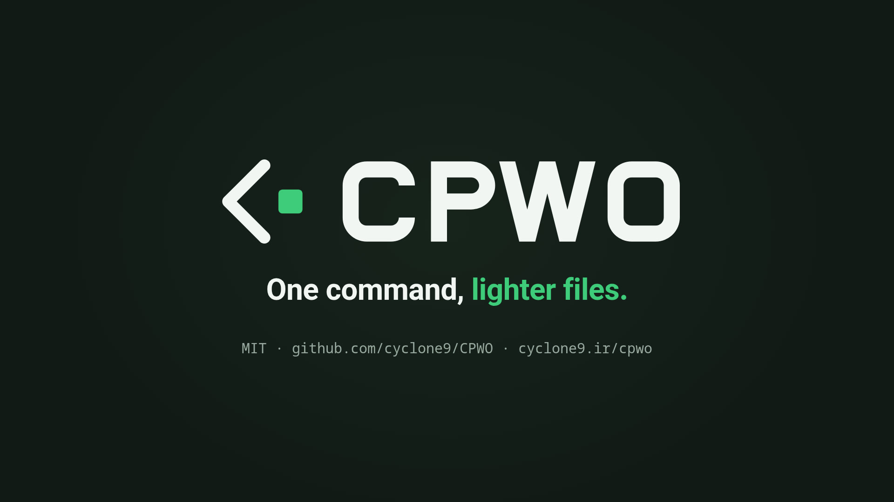

# CPWO - CyClone Power Web Optimizer

[English](README.md) | [فارسی](README.fa.md) | [Türkçe](README.tr.md) | [العربية](README.ar.md)

<p align="center"><picture><source media="(prefers-color-scheme: dark)" srcset="assets/cpwo-lockup-on-dark.svg"></picture></p>

Version 1.0.0 (2026-10-24). See [CHANGELOG.md](CHANGELOG.md).

A single binary that minifies HTML, CSS and JS, compresses images, and converts them to WebP and AVIF.

No cgo, nothing to install on the machine that runs it.

<p align="center"><a href="assets/cpwo-video-en.mp4"></a></p>

<p align="center">A 24-second look at CPWO. Click the image to open the video.</p>

```
cpwo [flags] <project-path>...
```

Point it at a project directory. It scans recursively and writes each result next
to the file it came from. Your sources are never modified. Flags can come before
or after the paths, so `cpwo ./site -avif` works. After a bare `--` everything is
a path.

```
style.css   ->  style.min.css        photo.jpg  ->  photo.webp
app.js      ->  app.min.js           photo.jpg  ->  photo-512.webp   (with -r)
index.html  ->  index.min.html       logo.png   ->  logo.avif        (with -avif)
```

Every run also writes a `.cpwo-output` file at the root, listing what it created.
The next run reads it to tell CPWO's files from yours.

## Flags

| Flag | Default | What it does |
|---|---|---|
| `-q <1-100>` | `82` | Quality for JPEG and lossy WebP. AVIF is scaled from it |
| `-r` | off | Also write resized variants, in every format that is on |
| `-sizes <list>` | `1024,512,256` | Widths for `-r`. Setting it turns `-r` on |
| `-resize-fallback` | off | Write resized JPEG/PNG next to the resized variants. Turns `-r` on |
| `-relink` | off | Point `<link href>` and `<script src>` at the `.min.` files that exist. Only CPWO's own have to be up to date |
| `-picture` | off | Wrap `` in `<picture>` with AVIF and WebP `<source>`s. Leaves an `` alone when it has a `srcset` or a `data-` attribute holding an image path |
| `-exif` | off | Keep the source EXIF in the re-encoded `.min.jpg` |
| `-only` | off | Run nothing but the groups named on the command line |
| `-overwrite` | off | Redo CPWO's own outputs even when they are up to date. Never overwrites a file CPWO did not make |
| `-adopt` | off | Take over files already sitting where CPWO writes, as if `.cpwo-output` listed them. For when the record was lost or never committed. Vendor files there are taken too, so check `-v` first |
| `-j <n>` | CPU count | Jobs, meaning how many files run in parallel |
| `-v` | off | Also print a line per file, and why a file was left alone. The summary still prints |
| `-version` | | Print the version |
| `-license` | | Print CPWO's license (MIT, with its copyright line), then one line for each component built into it: name, license and what CPWO uses it for. The full texts are in [licenses.md](licenses.md) |
| `-help`, `-h` | | Print usage |

### Exit status

| Code | Meaning |
|---|---|
| `0` | Done |
| `1` | Some files could not be processed. Each is reported, and the rest of the run still happens, manifest included |
| `2` | Bad usage, or a path that does not exist. Every path is checked before any work starts |

### Choosing what runs

`-html -css -js -json -svg -xml -img -webp` are all on by default. Name any of
them and only those run.

`-avif` is the exception: it is off until you ask for it, so naming it *adds* to
a normal run rather than narrowing the run to itself. It could not work the other
way round. Naming it is the only way to switch it on at all, so if it narrowed
like `-webp` does there would be no way to say "the usual, plus AVIF" without
spelling out all nine groups.

`-only` is how you get it by itself, and it works for any group.

```sh
cpwo -webp ./site           # only WebP conversion
cpwo -avif ./site           # the usual run, with AVIF as well
cpwo -avif -only ./site     # AVIF and nothing else
cpwo -webp -avif ./site     # only the two image formats
cpwo -avif -js=false ./site # the usual run, plus AVIF, minus JS
cpwo -css -js ./site        # only CSS and JS
cpwo -js=false ./site       # everything except JS
```

`-only` with no group named is an error rather than a run that does nothing.

`-img` recompresses JPEG and PNG at `-q`. `-webp` writes the `.webp` twins,
`-avif` the `.avif` ones.

### AVIF

AVIF is usually 30-50% smaller than the WebP of the same image, and every
current browser reads it. It is off by default for one reason: the encoder is
around ten times slower than the WebP one, which is the wrong trade for a tool
you may run every time you save. Turn it on for a release build and leave it off
while you work.

`-q` is a JPEG/WebP number, and AVIF does not use the same scale: `-q 82` handed
straight to it produces a *larger* file than the WebP. CPWO scales it for you, so
one `-q` covers all three formats and means roughly the same thing in each.

On camera-sized photos each AVIF encode needs well over a gigabyte of memory.
Four 12-megapixel photos at the default `-j` peaked at about 5 GB, so lower `-j`
on a machine with little RAM.

### Resizing

```sh
cpwo -r ./site                    # 1024, 512 and 256 wide
cpwo -sizes 512,256,128 ./site    # your own widths, -r implied
```

Aspect ratio is kept and nothing is ever upscaled, so a 400px source skips 512
and 1024. The original file is left alone.

Every format that is on gets resized, so `-r` on its own gives WebP variants and
`-r -avif` gives both:

```
cpwo -r ./site           photo.jpg  ->  photo-512.webp  photo-256.webp
cpwo -r -avif ./site     photo.jpg  ->  photo-512.webp  photo-256.webp
                                        photo-512.avif  photo-256.avif
```

Add `-resize-fallback` if you want same-format twins for an ``:

```
photo.jpg  ->  photo-512.webp  photo-512.min.jpg
               photo-256.webp  photo-256.min.jpg
```

The `.min.` in the fallback name matters. It keeps the variant out of the next
scan, so a second run cannot turn `photo-512.jpg` into `photo-512-256.jpg`.

## EXIF

A photo shot in portrait is usually stored landscape with an EXIF orientation
tag telling the viewer to turn it. Go's image decoder ignores that tag and none
of the encoders write one back, so CPWO turns the pixels itself before anything
else happens. Every output, `.min.jpg`, `.webp`, `.avif` and every resized copy,
comes out the same way up as the original does in your browser.

The rest of the EXIF block is dropped by default. It is dead weight on a web
image, often tens of kilobytes of camera settings and an embedded thumbnail, and
it is where GPS coordinates live.

`-exif` keeps it instead, for the one case where that matters: an author and
copyright you do not want to lose.

```sh
cpwo -exif ./site
```

Two limits, both structural rather than choices:

- It applies to the re-encoded `.min.jpg` only. WebP and AVIF cannot carry it,
  because their encoders here do not expose a way to write it, and a resized
  copy is a different image from the one the metadata describes, right down to
  the dimensions recorded in it.
- The orientation tag is reset to 1 on the way through. CPWO has already turned
  the pixels, so a tag that still said "turn me" would have the viewer do it
  twice.

If the segment is large enough to make the `.min.jpg` bigger than the source,
the usual rule applies and CPWO keeps the original instead.

## Rewriting markup

Both rewrites are off by default, since they change your markup. Neither touches
the source file. Only the minified copy is rewritten.

`-relink` points references at the minified twins:

```html
<link rel="stylesheet" href="assets/css/style.css">     <!-- in  -->
<link rel=stylesheet href=assets/css/style.min.css>     <!-- out -->
```

`-picture` wraps images and keeps every attribute the `` had:

```html

```
```html
<picture><source srcset="logo-128.avif" type="image/avif">
<source srcset="logo-128.webp" type="image/webp">
</picture>
```

The order matters: a browser takes the first `<source>` it understands, so the
smallest format has to come first.

Neither fires unless the replacement file is really on disk and, if CPWO made it,
not older than the file it was made from, so CPWO cannot point a page at
something it decided not to write, or at a stale copy. A vendor's own `.min.`
file only has to exist: archives unpack in any order, so its date says nothing
about whether it matches. CPWO leaves alone external URLs,
`data:` and site-root `/…` references, anything with `.min.` already in its name, an
`` that is already inside a `<picture>`, and `<link>` tags that are not CSS,
such as `rel="icon"`.

`-picture` also leaves an `` alone when it has a `srcset`: a single
full-size `<source>` would beat it on every screen, so a phone would download the
big image. The same goes for an `` with a `data-` attribute that holds an
image path, because a lazy-loader swaps that into `src` later and a `<source>` in
front would hide it for good.

`-picture` offers a format only if it beats everything a browser would otherwise
get. That is the rule CPWO writes by (see [Safety rails](#safety-rails)), so an
`.avif` has to be smaller than the `.webp` as well as the image.

Images are processed before HTML, so the check sees finished assets. HTML is
redone on every run while either flag is on, because the result depends on which
sibling files exist rather than on the page's own timestamp.

### Re-running

An output is skipped when it exists and is not older than its source, so a second
run does nothing and costs nothing. Edit one file and only that file is redone.
`-overwrite` redoes the lot, but only CPWO's own outputs. It never overwrites a
file CPWO did not make.

Outputs from earlier runs are held to the same rule as new ones (see
[Safety rails](#safety-rails)). When one no longer earns its place, CPWO removes
it: an `.avif` that a smaller `.webp` now beats, a `.webp` or `.min.png` of a
picture that has been replaced and no longer wins, a resized variant from when
the source was wider. Only files the `.cpwo-output` lists are ever removed. `-v`
names each one, and the summary counts them (`N outdated removed`).

Changing `-q` and running with `-overwrite` can remove a `.min.jpg` that no
longer beats its source, so do not link `.min.jpg` files by hand if you change
`-q`.

Records written by CPWO 0.2.1-beta and earlier listed any file they found up to
date at an output path, a hand-made `.webp` included. From 0.3.0 their entries
still count as CPWO's for overwriting, as before, but are never deleted: one that
would be removed as outdated is dropped from the record and left alone instead.
Until CPWO writes such a file itself, `.cpwo-output` names it in a header line,
`# Kept as found, never deleted: <path>`, so the rule holds on every later run.
Files taken over with `-adopt` get the same line.

Anything with `.min.` in the name, and anything ending in `.webp` or `.avif`, is
skipped.
That covers CPWO's own output, so you never get `style.min.min.css`, and it covers
vendored files: `bootstrap.min.css` and `bootstrap.bundle.min.js` are left exactly
as they ship. `node_modules`, `vendor` and dot-directories are never walked.

## The .cpwo-output file

One per project. It records what CPWO put in your project, and nothing else.

```
# Written by CPWO v1.0.0 on 2026-08-21 16:55:57
# Result: 16 sources -> 21 generated files, 322.1 KB -> 259.0 KB (19.6% smaller)

# File Map

┌────────────────────────────┬────────────────────────────────┐
│ Source                     │ Generated                      │
├────────────────────────────┼────────────────────────────────┤
│ assets/css/style.css       │ assets/css/style.min.css       │
│ assets/img/logo-128.png    │ assets/img/logo-128.min.png    │
│                            │ assets/img/logo-128.webp       │
│ assets/js/app.js           │ assets/js/app.min.js           │
│ index.html                 │ index.min.html                 │
└────────────────────────────┴────────────────────────────────┘

# File Tree

.
├── assets
│   ├── css
│   │   └── style.min.css
│   ├── img
│   │   ├── logo-128.min.png
│   │   └── logo-128.webp
│   └── js
│       └── app.min.js
└── index.min.html
```

It describes the files that exist, not just the ones the last run wrote, so a
re-run that changes nothing still gives you the full list. Paths are relative and
use forward slashes, and the file is plain UTF-8 without a BOM, so it reads the
same everywhere.

A run merges what it did into the existing file, so a narrower run
(`cpwo -webp`) or a run on a single file keeps the record of everything else. A
run on a file (what a save hook passes) or on a folder records into the nearest
`.cpwo-output` at or above it, and the search stops at the top of a git checkout.
Only when there is none does it start one there (for a file, in the file's
folder).

A `.cpwo-output` that an older run on a single subfolder left behind is folded
into the project's record and removed. When nothing of CPWO's is left, the
`.cpwo-output` itself is removed.

### Files CPWO leaves alone

CPWO reads the `.cpwo-output` at the start of every run and only ever replaces or
removes a file listed there, or in a `.cpwo-output` further up the tree. Anything
else sitting where an output would go is left alone: a vendor's
`bootstrap.min.css` next to `bootstrap.css`, or a `.webp` someone exported by
hand.

Two sources can want the same output, as `photo.jpg` and `photo.png` both want
`photo.webp`. The first in name order gets it, on every run, and the other is
left alone.

The summary line counts these (`N left alone`), and `-v` names each one and says
why. If outputs exist but there is no `.cpwo-output` to list them (it was
deleted, or never committed), CPWO leaves them alone and prints a hint naming how
many and pointing at `-adopt`. Running once with `-adopt` takes them over, and
from then on the record lists them.

### Git

Keep `.cpwo-output` and the outputs together, either both committed or both
ignored. After a clone, committed outputs without their manifest are left alone
by the next run, which prints a hint pointing at `-adopt`. Running once with
`-adopt` takes them over.

If you ignore them, un-ignore the files that ship already minified, because
`*.min.*` matches those too. Do the same for any `.webp` or `.avif` you made
yourself:

```gitignore
.cpwo-output
*.min.*
*.webp
*.avif
!bootstrap.min.css
!bootstrap.bundle.min.js
```

## Safety rails

If optimizing makes a file bigger, CPWO keeps the original. This comes up more
than you would expect: at `-q 82` a lossy WebP of a flat-colour logo is often
bigger than the source PNG. So PNG sources are encoded both lossy and lossless,
the smaller one wins, and if it still cannot beat the source then no `.webp` is
written at all.

The same rule runs one step further for AVIF. `<picture>` offers the `.avif`
first, so an `.avif` only earns its place if it beats the `.webp` as well as the
source. From a real logo set:

```
logo-512.png  23,799  ->  logo-512.webp   9,996  ->  logo-512.avif  5,881
logo-256.png  10,782  ->  logo-256.webp   8,586  ->  logo-256.avif  2,912
logo-32.png    2,667  ->  logo-32.webp      656  ->  no .avif, AVIF came out 756
```

When a minifier rejects a file's syntax, CPWO copies the file rather than lose it.

Every file is written to a temporary file and renamed into place, so an
interrupted run never leaves half a file that later runs would treat as up to
date.

An image wider or taller than 16383 px gets no `.webp`, because that is the
format's limit. CPWO prints a warning and moves on.

Images are turned the right way up before they are re-encoded, so a `<picture>`
cannot end up serving a sideways WebP next to an upright JPEG. See [EXIF](#exif).

HTML keeps default attribute values. Dropping `type="text"` from an `<input>` is
valid HTML and saves a few bytes, but it also stops every `input[type="text"]` CSS
rule and `querySelector` from matching. The page still renders, it just looks
wrong. CPWO will not make that trade.

## What happens to which file

| Extension | Action |
|---|---|
| `.html .htm` | Minified, plus `-relink` and `-picture` if asked |
| `.css .js .mjs .json .svg .xml` | Minified |
| `.jpg .jpeg .png` | Recompressed at `-q`, plus a `.webp` and, with `-avif`, an `.avif` alongside |
| `*.min.*`, `*.webp`, `*.avif` | Skipped, already minified or CPWO's own work |
| anything else | Left alone |

Originals stay put, so `<picture>` fallbacks keep working, which is what
`-picture` writes for you.

## Dependencies

All pure Go.

| Module | License | Used for |
|---|---|---|
| [tdewolff/minify/v2](https://github.com/tdewolff/minify) | MIT | HTML, CSS, JS, JSON, SVG and XML minification |
| [gen2brain/webp](https://github.com/gen2brain/webp) | MIT. Bundles libwebp 1.6.0 (BSD-3-Clause) | WebP encoding, lossy and lossless |
| [gen2brain/avif](https://github.com/gen2brain/avif) | MIT. Bundles libavif 1.4.2 (BSD-2-Clause) with aom 3.14.1 (BSD-2-Clause), dav1d and libyuv | AVIF encoding |
| [golang.org/x/net/html](https://pkg.go.dev/golang.org/x/net/html) | BSD-3-Clause | HTML parsing for `-relink` and `-picture` |
| [golang.org/x/image/draw](https://pkg.go.dev/golang.org/x/image/draw) | BSD-3-Clause | Downscaling for `-r` |
| [tdewolff/parse/v2](https://github.com/tdewolff/parse) | MIT | Parsers behind the minifiers, pulled in indirectly |
| [tetratelabs/wazero](https://github.com/tetratelabs/wazero) | Apache-2.0 | Runs the AVIF encoder's WebAssembly, pulled in indirectly |
| [golang.org/x/sys](https://pkg.go.dev/golang.org/x/sys) | BSD-3-Clause | CPU detection and system calls, pulled in indirectly |
| [ebitengine/purego](https://github.com/ebitengine/purego) | Apache-2.0 | Called by the encoders, pulled in indirectly. Not in release builds: it is only linked without `-tags nodynamic` |
| [goreleaser](https://github.com/goreleaser/goreleaser) | Not shipped | Build time only, for cutting releases |

Everything else is the Go standard library (BSD-3-Clause). The full license
texts are in [licenses.md](licenses.md), with short versions under
[License](#license).

## Updating dependencies

`scripts/deps.sh` lists every Go module with its current and latest version and
its repository, then the C libraries compiled into the encoders, the Go
toolchain and the GitHub Actions in use, and says which have updates.

```sh
scripts/deps.sh             # what has an update
scripts/deps.sh --apply     # update the outdated modules, go mod tidy, run the tests
scripts/deps.sh licenses    # regenerate licenses.md
```

`licenses` rewrites [licenses.md](licenses.md). Run it after any dependency
update, because a test fails until you do. The script needs bash and curl, plus
Go for `--apply` and `licenses`. `GITHUB_TOKEN` lifts GitHub's limit of 60
anonymous API calls an hour.

## Build

```sh
go mod tidy
go test -tags nodynamic ./...
go build ./...
```

`go test -tags nodynamic ./...` must pass. Without the tag the encoders use a
system libwebp/libavif when one is installed, so the tests would measure a
different encoder from the one that ships. `scripts/build.sh` then cross-compiles
all six targets into `bin/<os>-<arch>/`, such as `bin/linux-amd64/cpwo` and
`bin/windows-amd64/cpwo.exe`. It also writes `bin/SHA256SUMS` and, when `file` is
installed, checks that the Linux binaries are static.

```sh
scripts/build.sh                             # all six targets
scripts/build.sh linux/amd64 windows/amd64   # only these
VERSION=1.2.3 scripts/build.sh               # stamp a version
```

The version defaults to the git tag, and to the one in `main.go` when there is no
tag.

Release builds use `-tags nodynamic`. Without it the WebP and AVIF packages look
for a system libwebp/libavif at startup, and the Linux binary stops being static.
For a quick local build:

```sh
CGO_ENABLED=0 go build -tags nodynamic .
```

On GitHub, every push and pull request runs the tests on Linux, Windows and
macOS, then builds all six targets. The binaries are attached to the workflow run
as an artifact named `cpwo-<commit>`. Pushing a tag `vX.Y.Z` runs the tests and
cuts a release with GoReleaser, which builds the same six targets.

## License

CPWO is released under the MIT License, Copyright (c) 2026 CyClone
(https://cyclone9.ir). The full text is in [LICENSE](LICENSE).

The MIT License covers CPWO's code and documentation. It does not cover the CPWO logo, the cover images or the videos in [assets/](assets/), which belong to CyClone, all rights reserved. The music in the videos is licensed separately from a third party and is not part of CPWO.

A CPWO binary also contains third-party code under MIT, BSD and Apache-2.0
licenses. [licenses.md](licenses.md) reproduces every license text.
`cpwo -license` prints CPWO's own license (MIT, with its copyright line) and one
line for each component (name, license, what CPWO uses it for), then points to
licenses.md for the full texts. Release archives ship LICENSE, licenses.md and
the READMEs, and `scripts/build.sh` copies LICENSE and licenses.md into `bin/`
beside the binaries.

### The licenses in plain terms

Short versions of the licenses in the [Dependencies](#dependencies) table. Each
provides the code as is, without warranty, and the full texts in
[licenses.md](licenses.md) are what apply.

| License | You may | You must |
|---|---|---|
| MIT | Use, copy, change, publish, distribute and sell the code | Keep the copyright notice and the license text with every copy |
| BSD-2-Clause | Use and redistribute the code, changed or not | Keep the copyright notice, the license text and the disclaimer, in the source and in the documentation that comes with a binary |
| BSD-3-Clause | The same as BSD-2-Clause | The same as BSD-2-Clause, and not use the authors' names to endorse or promote a product built from the code without written permission |
| Apache-2.0 | Use, change and redistribute the code. Contributors also grant you a license to their patents | Keep the license, the copyright notices and the NOTICE file, and mark the files you changed. The patent license ends for you if you sue over a patent in the code. The license gives no right to use trademarks |
